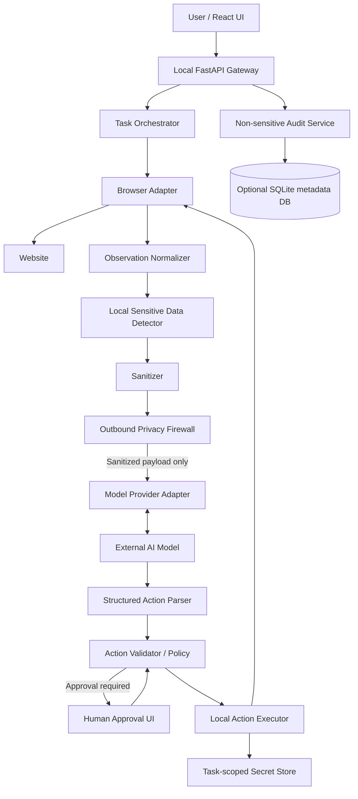
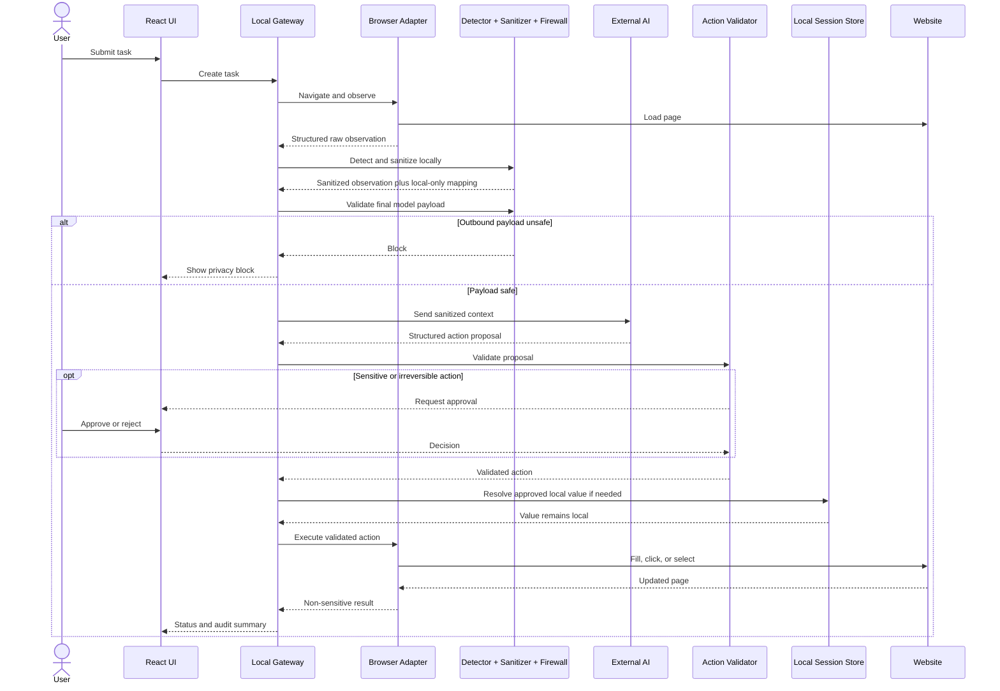

# PrivacyLens — Architecture

## 1. Architecture decision

Implement PrivacyLens as a **local privacy gateway with one controlled browser-agent integration**. The gateway is the core product. Browser automation is an adapter that supplies observations and executes validated actions.

The MVP controls its own agent-to-model communication path. It does not attempt to transparently intercept arbitrary consumer AI applications. Additional providers or agent frameworks can be integrated later through adapters.

## 2. High-level architecture



## 3. Trust boundaries

### A. Website to local application
Webpage content is untrusted. It may contain malicious instructions, hidden values, deceptive labels, or content intended to manipulate the agent.

Controls:
- Treat webpage text as data, never as privileged instructions.
- Normalize page observations into a constrained schema.
- Exclude hidden elements unless a task explicitly requires them.
- Preserve element IDs and source context for validation.
- Never allow page content to modify system policy or permissions.

### B. Local application to external model
This is the primary privacy boundary.

Controls:
- Every model call must pass through one gateway function.
- No direct provider SDK calls from frontend or browser modules.
- Sanitize text and structured fields before prompt construction.
- Scan the final serialized request for known local secret values and synthetic canaries.
- Reject unresolved sensitive patterns and any raw-value mapping.
- Do not log full prompts or raw request/response bodies.
- Keep provider credentials out of source control and frontend bundles.

### C. Model output to browser execution
Model output is untrusted and may be malformed, overbroad, or manipulated by page content.

Controls:
- Require strict structured output.
- Reject unknown action types and arbitrary executable code.
- Resolve targets locally; do not blindly trust model-supplied selectors.
- Enforce origin, target, and permission policies.
- Require approval for consequential actions.
- Bound action count, retries, and execution time.

### D. Local secret store to website
A website may need the real value to complete a user-requested task; the model does not.

Controls:
- Model requests a semantic operation such as `fill_local_value`, with a field purpose.
- Local policy maps the purpose to an approved local value.
- Never return the resolved value to the model or action result.
- Fill only an approved field on an approved origin.
- Require consent for sensitive value use.
- Clear task values at completion, cancellation, or timeout.

## 4. Component design

### 4.1 FastAPI gateway and orchestrator
- Bind to `127.0.0.1` by default.
- Own task/session state and approval workflow.
- Coordinate browser observation, privacy pipeline, model call, validation, and execution.
- Expose privacy preview and status endpoints.
- Ensure all model calls pass through the firewall.

### 4.2 Browser adapter
The browser adapter is replaceable. Playwright can implement it, but Playwright imports must not leak into the detector, sanitizer, policy engine, or model adapter.

Suggested interface:

```python
class BrowserAdapter:
    async def navigate(self, url: str) -> "PageState": ...
    async def observe(self) -> "PageObservation": ...
    async def execute(self, action: "ValidatedAction") -> "ActionResult": ...
    async def close(self) -> None: ...
```

It must execute only validated action objects and return results without sensitive values.

### 4.3 Observation normalizer
Convert browser state into a bounded structure, for example:

```json
{
  "url": "https://example.test/checkout",
  "title": "Checkout",
  "visible_text": "Contact details ...",
  "elements": [
    {
      "element_id": "el_12",
      "role": "textbox",
      "label": "Email address",
      "input_type": "email",
      "name": "email",
      "value": "person@example.test",
      "visible": true,
      "enabled": true
    }
  ]
}
```

Raw values may exist transiently in local process memory for detection. They must not be logged or sent to the model before sanitization. Use stable per-observation element IDs rather than model-invented CSS selectors.

### 4.4 Sensitive-data detector
Use defense in depth:
1. **Structural signals:** password input type, autocomplete, labels, names, placeholders, ARIA labels, nearby text.
2. **Pattern matching:** email, phone, PAN-like identifiers, Aadhaar-like identifiers, card-like numbers, API tokens, IP addresses, OTP-like values, and configured categories.
3. **Validation:** use format/checksum validation where applicable; a regex match alone is not proof for every identifier.
4. **Context:** combine candidate value with field label and surrounding text to reduce false positives.

Detection results should include category, source element/span, detection method, confidence, and a local-only reference to the original value. Never include raw values in diagnostics.

### 4.5 Sanitizer
- Replace sensitive spans with semantic placeholders.
- Preserve labels, element IDs, roles, and useful non-sensitive context.
- Remove duplicate copies in attributes/metadata.
- Produce a sanitized observation and a redaction report containing no raw value.
- Keep any placeholder-to-original mapping strictly local.

Example:

```text
Passenger: [REDACTED:PERSON]
Email: [REDACTED:EMAIL]
Phone: [REDACTED:PHONE]
Departure: Delhi
Destination: Mumbai
```

### 4.6 Outbound privacy firewall
The firewall is the final enforcement point immediately before model transmission.

Required sequence:
1. Accept only a sanitized payload object.
2. Serialize the exact payload that will be sent.
3. Scan for known local secret values and synthetic canaries.
4. Scan for unresolved sensitive patterns.
5. Verify no secret mapping or local secret reference is present.
6. Block on any failure and record a metadata-only event.
7. Invoke the model provider only after a pass decision.

A pattern scan cannot prove that every unknown secret is absent. Strong evidence combines structured sanitization, known-value/canary checks, and tests of all model-bound paths.

### 4.7 Model provider adapter
Responsibilities:
- Convert sanitized task context into a provider request.
- Request strict structured output.
- Parse and normalize provider-specific responses.
- Keep provider SDK types out of core modules.

Suggested interface:

```python
class ModelProvider:
    async def propose_actions(
        self,
        task: str,
        sanitized_observation: "SanitizedObservation"
    ) -> list["ProposedAction"]: ...
```

Only one provider is required for the MVP.

### 4.8 Action schema and validator
Use a small allowlisted action vocabulary. Example:

```json
{
  "actions": [
    {
      "type": "click",
      "target_element_id": "el_21",
      "reason": "Continue to passenger details"
    },
    {
      "type": "fill_local_value",
      "target_element_id": "el_12",
      "value_purpose": "email",
      "reason": "Fill the contact email field"
    }
  ]
}
```

MVP action types may include:
- `click`
- `select_option`
- `fill_public_value`
- `fill_local_value`
- `scroll`
- `wait_for_element`
- `request_user_approval`

Do not support arbitrary JavaScript, shell commands, unrestricted file access, or arbitrary model-generated code.

Validator checks:
- Action type is allowlisted.
- Target element ID exists in the latest observation.
- Target is visible, enabled, and semantically appropriate.
- Requested value purpose is permitted for the field.
- Current origin is allowed.
- Action is within task policy.
- High-impact actions have explicit approval.
- Action count and retry count are bounded.

### 4.9 Local secret store and injection
Use an in-memory per-task store for the MVP. Do not persist raw secrets in SQLite.

Rules:
- Generate unguessable local references.
- Never include references or values in model prompts/tool outputs.
- Do not resolve a value solely because the model supplied an arbitrary key.
- Require known purpose and user-approved profile mapping.
- Check target field and page origin.
- Do not include values in action result messages.
- Clear values after completion, cancellation, timeout, and shutdown.
- Do not claim guaranteed memory zeroization in a garbage-collected runtime.
- If persistent storage is later necessary, use OS-backed secure storage or a vetted secrets-management mechanism; do not invent custom cryptography.

### 4.10 Human approval
Require approval for at least:
- Submit payment/place order.
- Confirm booking.
- Send a message containing personal information.
- Change account security settings.
- Submit identity documents or sensitive forms.
- Any action classified as irreversible or high impact.

Show the action and destination clearly. Avoid revealing secrets unnecessarily. Allow rejection.

### 4.11 Audit and observability
Safe metadata includes task ID, timestamp, event type, category/count, firewall decision, action type, validation result, approval decision, duration, and error code.

Never persist raw page text, raw screenshots, original values, secret mappings, full prompts, or full model responses if they may contain sensitive data.

## 5. End-to-end sequence



## 6. Suggested local API

| Method | Route | Purpose |
|---|---|---|
| `POST` | `/api/tasks` | Create task/session |
| `GET` | `/api/tasks/{task_id}` | Read task status |
| `POST` | `/api/tasks/{task_id}/observe` | Request observation |
| `GET` | `/api/tasks/{task_id}/privacy-preview` | Read sanitized preview/counts |
| `POST` | `/api/tasks/{task_id}/run` | Request next model proposal |
| `POST` | `/api/tasks/{task_id}/approval` | Approve/reject pending action |
| `POST` | `/api/tasks/{task_id}/cancel` | Cancel and clear session values |
| `GET` | `/api/tasks/{task_id}/audit` | Read metadata-only audit events |
| `GET` | `/health` | Local health check |

Do not expose an endpoint that returns the secret store or raw unsanitized observations to the frontend.

## 7. Suggested repository structure

```text
privacylens/
├── frontend/
│   └── src/{components,pages,api,types}/
├── backend/
│   ├── app/
│   │   ├── main.py
│   │   ├── api/
│   │   ├── core/{config.py,policy.py}
│   │   ├── browser/{interface.py,playwright_adapter.py}
│   │   ├── privacy/{models.py,detector.py,classifier.py,sanitizer.py,firewall.py}
│   │   ├── agent/{orchestrator.py,actions.py,validator.py,executor.py}
│   │   ├── providers/{base.py,provider_one.py}
│   │   ├── secrets/session_store.py
│   │   ├── audit/
│   │   └── db/
│   ├── tests/
│   └── requirements.txt
├── docs/{ARCHITECTURE.md,AGENTS.md,DATABASE_SCHEMA.md,PROJECT_OVERVIEW.md}
├── .env.example
├── .gitignore
└── README.md
```

## 8. Failure behavior

| Failure | Required response |
|---|---|
| Detector or sanitizer exception | Stop; do not call model |
| Firewall finds canary/raw secret | Block; metadata-only event |
| Model returns invalid structure | Reject; bounded retry or stop |
| Model proposes unknown action | Reject |
| Target element is stale/missing | Re-observe; never guess |
| Local value purpose is unknown | Reject and ask user |
| Approval denied | Do not execute |
| Page changes to unexpected origin | Pause and revalidate |
| Browser execution fails | Stop or bounded recovery; do not expose values in errors |
| User cancels | Stop and clear task values |

## 9. Testing requirements

### Unit tests
- Positive and negative examples for every detector.
- Contextual field detection.
- Placeholder replacement and span offsets.
- Sanitized output excludes planted canaries.
- Firewall blocks raw canary and permits sanitized payload.
- Unknown actions are rejected.
- Sensitive actions require approval.
- Secret values never appear in audit output.

### Integration/security tests
- Browser observation passes through detector and sanitizer.
- Model adapter receives sanitized data only.
- Firewall failure prevents model invocation.
- Local injection fills correct field without returning the value.
- Hidden DOM values and duplicate metadata are handled.
- Prompt injection in page text cannot change policy.
- Logs and exception messages contain no raw values.

Use synthetic data only. Report actual test results and qualify claims by tested paths.

## 10. Implementation order

**MVP:** browser adapter → observation normalizer → DOM/pattern detection → text sanitization → outbound firewall → one model adapter → action schema/validator → local secret injection → human approval → dashboard/audit → end-to-end tests.

**Deferred:** OCR, advanced computer vision, multiple providers, cross-browser support, persistent secret vault, advanced ML-based contextual detection.

## 11. Non-negotiable data path

The only allowed path to an external model is:

`Raw Observation → Normalize → Detect → Sanitize → Outbound Firewall → Model Adapter`

Any alternate model call path is a security defect.
